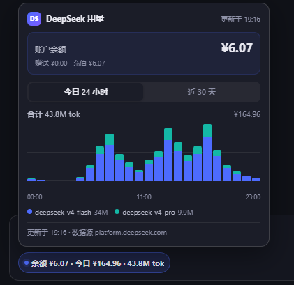

# deepseek-quota — WebUI 扩展

在 Hermes 聊天 WebUI 的输入框按钮排加一个 DeepSeek 账户芯片：

- **芯片**：`余额 ¥6.07 · 今日 ¥0.42 · 12.3M tok`
- **悬浮卡片**（桌面 hover / 触屏点击）：余额明细 + 两个 tab 的 token 用量柱状图
  - 「今日 24 小时」：按小时分桶
  - 「近 30 天」：按天分桶
  - 柱子按模型堆叠，hover/点击单根柱显示该时段的输入 / 缓存输入 / 输出 token、费用和分模型明细（缓存输入附命中率）
- token 量按 K / M / B 显示，金额一律 CNY（账户币种是 USD 时显示 `$`，不做汇率换算）



> 示意图，数值为 mock 数据；实际显示以账户为准。

## 数据源与凭证

| 数据 | 接口 | 鉴权 | 说明 |
|---|---|---|---|
| 余额 | `GET https://api.deepseek.com/user/balance` | `DEEPSEEK_API_KEY` | 官方文档接口，长期有效 |
| 今日费用 / token / 图表 | `GET https://platform.deepseek.com/api/v0/usage/by_api_key/{amount,cost}?start=&end=&tz=28800` | `DEEPSEEK_PLATFORM_TOKEN` | **平台私有接口**，官方未公开承诺 |

两个凭证都只由 sidecar 在服务器侧读取（`~/.hermes/.env`），浏览器永远拿不到。

### 平台 token 怎么来

用量/费用接口不吃 API key，要的是 `platform.deepseek.com` 网页登录后的 userToken：

1. 浏览器登录 <https://platform.deepseek.com>
2. DevTools → Console 执行：
   ```js
   JSON.parse(localStorage.getItem('userToken')).value
   ```
3. 用仓库里的脚本写入（**不要**把 token 贴到聊天/命令行参数里）：

   ```bash
   python3 scripts/set_token.py
   ```

   脚本会删掉旧的/占位的 `DEEPSEEK_PLATFORM_TOKEN=` 行，交互式读取 token，原子写入并设成 `600`，最后通过 sidecar 验证一次。也可以手动写进 `~/.hermes/.env`，但别用 `KEY=$VAR` 形式的一行命令——聊天界面可能把 `$VAR` 脱敏成 `***`，复制回来就写错了。

token 过期后：余额芯片继续正常，卡片里的用量区显示「platform token 无效或已过期」；重新取一个写回 `.env` 即可，**不用重启 sidecar**（每次请求都重新读 `.env`）。

> 私有接口随时可能改路径/字段。真的变了，先跑 `python3 scripts/probe_usage.py` 看新结构，再改 `sidecar/routes_impl.py` 的解析层；余额功能不受影响。

## 架构

- `sidecar/` — 常驻本地小服务（systemd user 服务 `deepseek-quota-sidecar.service`，端口 **17801**，开机自启）。
  - `GET /api/summary`：余额 + 今日汇总，缓存 60s
  - `GET /api/usage?range=today|30d`：图表分桶，today 缓存 60s、30d 缓存 300s
  - 失败结果只缓存 20s，一次抖动不会脏一分钟
- `assets/deepseek-quota.js` — 前端注入。摘要每 60s 走同源代理
  `/api/extensions/deepseek-quota/sidecar/api/summary`；卡片打开时按 tab 取图表，120s 刷新。
- 鉴权：`proxy_auth: token-v1`。WebUI 铸 per-extension token
  `~/.hermes/webui/sidecar-auth/deepseek-quota.token`，代理注入
  `X-Hermes-Sidecar-Token`，sidecar 每请求校验（缺文件 503 / 错 token 401）。
- 按需取数：没人开 WebUI 就没人调用，上游零请求。
- 上游仓库 `/root/production/hermes-webui` **零改动**。

## 运维

```bash
systemctl --user status deepseek-quota-sidecar     # 状态
journalctl --user -u deepseek-quota-sidecar -f     # 日志
curl -s http://127.0.0.1:17801/health              # 无需 token 的存活探针
```

Consent 状态：`GET /api/extensions/status`（或 Settings → Extensions）。
撤销 consent 后代理即断；sidecar 进程本身不含秘密，可随时停。

## 安装 / 卸载（插件式）

```bash
./manage.sh install     # 同步文件+登记+部署 systemd 单元+探活
./manage.sh uninstall   # 停服务+撤 consent+删 token+删文件+清登记
./manage.sh status      # 一屏总览（文件/登记/consent/token/服务/健康）
./manage.sh doctor      # 凭证/端口/token/注入链路/端到端取数 五项体检
```

- 首次 install 后需在 Settings → Extensions 批准一次代理 consent（token 同步铸造）。
- 升级 = 改完代码再跑 `install`（幂等，rsync 覆盖 + 服务重启 + 刷新页面）。
- 秘密不进本包；sidecar 运行时读 `~/.hermes/.env`。
- 本地包不走官方 `/api/extensions/install`（只认公网 gallery 且不管理进程）；
  按官方 "Next step" 模式自带生命周期脚本。

## 已知限制

- 用量接口是平台前端自用端点，没有 SLA；`by_api_key` 返回的是账号下**所有** key 的合计（卡片不区分单把 key）。
- 平台只给「当日/区间」分桶，不给「当前这一小时进行到哪」的秒级实时值；60s 缓存已经是合理粒度。
- 用量接口要求 `start`/`end` 对齐分桶边界（整点/整日），带分钟的 `now` 会返回 `biz 1 INVALID_PARAM`。sidecar 固定请求 `[今日 00:00, 次日 00:00)` 和 30 个完整日桶，所以图表末尾会出现未来的空柱，属正常。
- 账户同时有 USD / CNY 钱包时，余额取 CNY；费用取 cost 接口返回的 CNY 序列。
- systemd 单元硬编码默认状态目录；若用 `HERMES_WEBUI_STATE_DIR` 重定位，需同步改 `lifecycle/` 下的单元文件。
